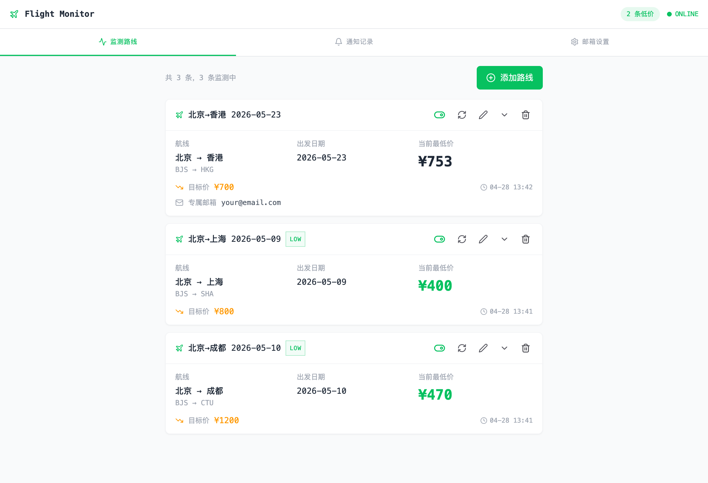

# Flight Monitor - 机票价格监测助手

一个轻量级的机票价格监测工具，支持自动抓取携程机票最低价、价格趋势追踪、邮件降价提醒。



## 功能特性

- **多航线监测** — 同时监测多条航线，支持国内及国际城市
- **自动抓取** — 基于 Playwright 无头浏览器，自动抓取携程低价日历数据
- **价格趋势** — 记录历史价格，支持 Sparkline 趋势图展示
- **邮件告警** — 价格低于目标且创历史新低时，自动发送 HTML 邮件通知
- **灵活配置** — 支持为每条航线设置独立收件邮箱，支持 QQ/163/Gmail 等邮箱
- **Docker 一键部署** — 多阶段构建，开箱即用

## 技术栈

| 层级 | 技术 |
|------|------|
| 前端 | React 18 + TypeScript + Vite + Tailwind CSS |
| 后端 | Python FastAPI + SQLite |
| 爬虫 | Playwright (Chromium headless) |
| 部署 | Docker + Docker Compose |

## 快速部署

### 前提条件
- 一台云服务器（已安装 Docker 和 Docker Compose）
- 开放 9400 端口

### 一键部署

```bash
git clone https://github.com/uestc-er/flight-monitor.git
cd flight-monitor
bash deploy.sh
```

或者手动部署：

```bash
docker compose up -d --build
```

部署完成后访问 `http://你的服务器IP:9400`

### 常用命令

```bash
docker compose logs -f        # 查看日志
docker compose restart         # 重启服务
docker compose down            # 停止服务
docker compose up -d --build   # 更新后重新部署
```

## 本地开发

### 后端

```bash
pip install -r requirements.txt
playwright install chromium
python server.py
```

### 前端

```bash
npm install
npm run dev
```

## 项目结构

```
flight-monitor/
├── server.py              # 后端：API + 爬虫 + 邮件 + 定时任务
├── index.tsx              # 前端：主页面
├── constants.ts           # 共享常量（城市代码、样式等）
├── components/
│   ├── CityPicker.tsx     # 城市选择器（支持搜索）
│   ├── Panel.tsx          # 面板 + Sparkline 趋势图
│   ├── RouteCard.tsx      # 航线卡片
│   ├── RouteModal.tsx     # 添加/编辑航线弹窗
│   └── SettingsPanel.tsx  # 邮箱设置面板
├── Dockerfile             # 多阶段构建
├── docker-compose.yml     # 容器编排
├── deploy.sh              # 一键部署脚本
└── requirements.txt       # Python 依赖
```

## 免责声明

本项目仅供学习和个人使用，请勿用于任何商业用途。机票价格数据来源于第三方网站，本项目不保证数据的准确性和实时性。使用者应遵守相关网站的服务条款，因使用本项目产生的任何问题由使用者自行承担。

## License

MIT
